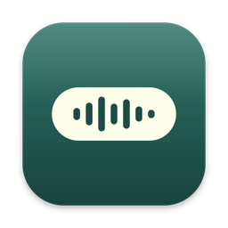
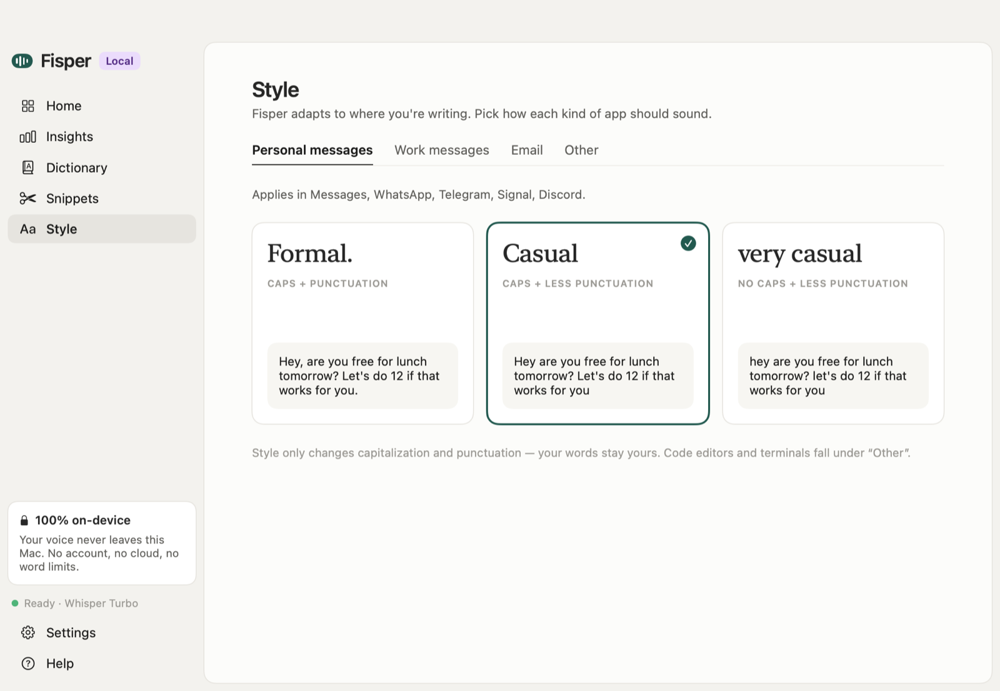
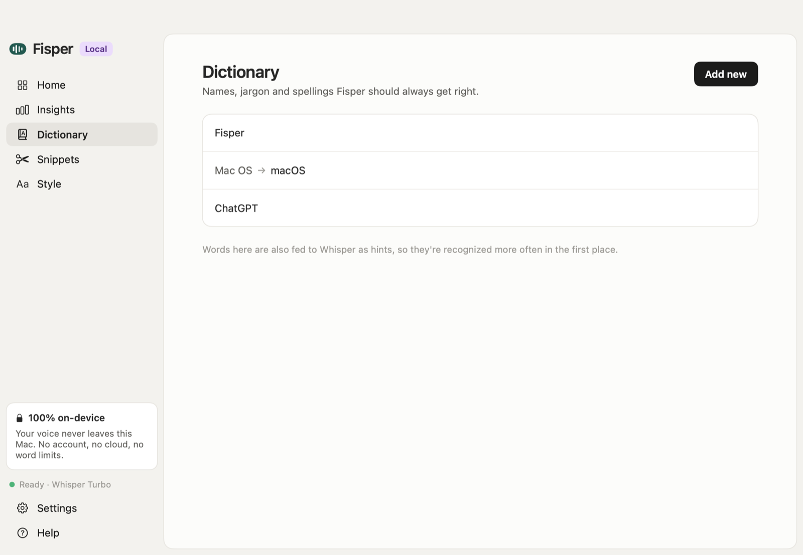
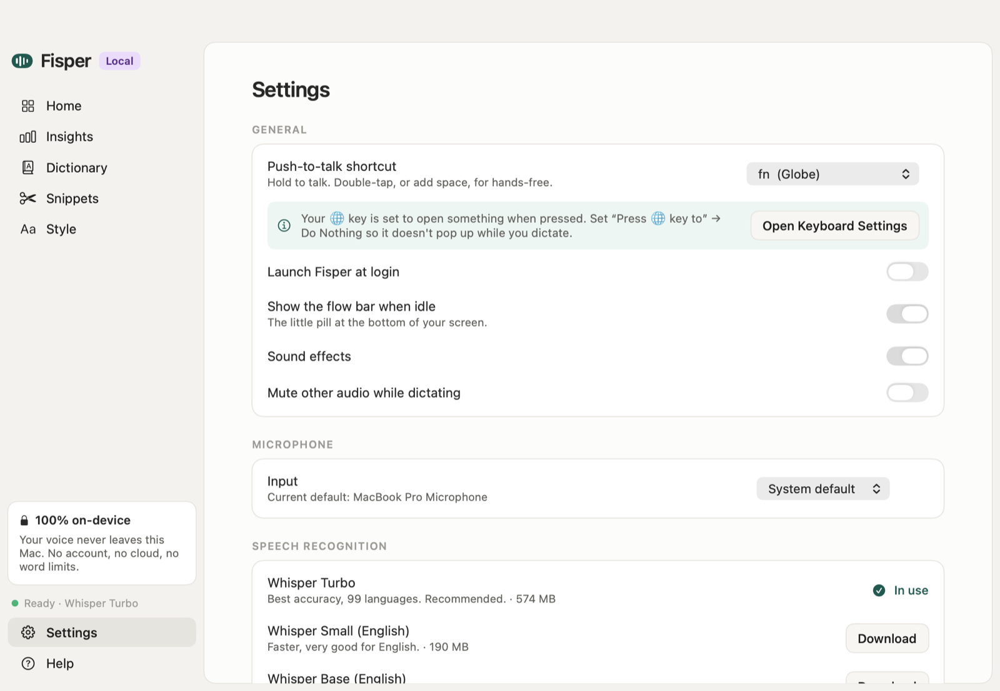

<p align="center">
  
</p>

<h1 align="center">Fisper</h1>

<p align="center">
  <b>Don't type, just speak.</b><br>
  Free, open-source, 100% on-device voice dictation for macOS.<br>
  Hold <kbd>fn</kbd>, talk, release — clean, punctuated text appears in whatever app you're using.
</p>

<p align="center">
  
</p>

---

## Why

Cloud dictation apps are great, but they send your voice to a server, cap your words, and cost a subscription.
Fisper does the same job **entirely on your Mac**: Whisper runs on the GPU for speech-to-text, and a local language model (Apple Intelligence or Ollama) cleans up what you said. No account, no network, no limits.

## Features

- **Hold-to-talk anywhere** — hold <kbd>fn</kbd> (or right ⌥, right ⌘, ⌃⌥), speak, release. Text is pasted at your cursor in any app: Messages, Mail, Slack, Notes, VS Code/Cursor, terminals, ChatGPT/Claude…
- **Hands-free mode** — double-tap the key, or press <kbd>space</kbd> while holding it. Finish with the key again or the ✓ button. <kbd>Esc</kbd> cancels.
- **Auto-correct that understands you**
  - removes *um / uh*, stutters and repeated words
  - applies self-corrections — *"let's meet Tuesday, no wait, Wednesday"* → *"Let's meet Wednesday."*
  - fixes punctuation, capitalization and grammar
  - turns spoken lists into real lists; *"new line"* / *"new paragraph"* work
  - never "answers" what you dictate: every AI rewrite is validated, and anything suspicious falls back to the deterministic cleaner
- **Fast** — ~0.3–0.6 s transcription for a typical sentence on Apple Silicon (adaptive Whisper context + warm model), ~1 s total from release to text.
- **Style per app** — Formal / Casual / very casual for personal messages, work chat, email and everything else.
- **Dictionary** — teach it names and jargon (*"chat GPT → ChatGPT"*); words are also fed to Whisper as hints.
- **Snippets** — say *"my email"* or *"my calendar link"* and get the full text.
- **Smart insertion** — adds a leading space or lowercases mid-sentence based on the text around your cursor; restores your clipboard afterwards.
- **History & Insights** — searchable history with copy / *transcribe again*, words-per-minute, streaks and usage heatmap.
- **Reliable** — crash-isolated speech engine that restarts itself, self-healing hotkey listener, silence/hallucination filtering ("We couldn't hear you" instead of a random "Thank you."), automatic retry on Whisper repetition loops, failed dictations saved for retry.
- **99 languages** with Whisper Turbo, plus lighter English models.

<p align="center">
  
  <br><sub>The flow bar: idle · recording · hands-free · processing</sub>
</p>

| Insights | Style |
|---|---|
|  |  |
| **Dictionary** | **Settings** |
|  |  |

## Requirements

- Mac with **Apple Silicon** (M1 or later)
- **macOS 26** or later
- ~600 MB disk for the default speech model
- Optional: **Apple Intelligence** turned on *or* [Ollama](https://ollama.com) with a small model (e.g. `ollama pull qwen2.5:3b`) for AI clean-up. Without either, Fisper still removes fillers, stutters and fixes spacing with built-in rules.

## Install

### Download

Grab `Fisper.dmg` from [Releases](../../releases), drag **Fisper** to Applications.

Fisper is ad-hoc signed (no paid Apple developer account), so the first time macOS may say it can't verify the developer. Either right-click the app → **Open**, or run:

```bash
xattr -dr com.apple.quarantine /Applications/Fisper.app
```

### Build from source

```bash
git clone https://github.com/claudecodebypasscuzofage-star/fisper.git
cd fisper
brew install cmake        # only needed the first time, to build whisper.cpp
./scripts/build.sh --install
```

`--install` copies the app to `/Applications` and launches it. Use `--dmg` to also produce `build/Fisper.dmg`.

## First run

1. **Microphone** — allow it when asked.
2. **Accessibility** — System Settings → Privacy & Security → Accessibility → turn on **Fisper**. This lets it notice your shortcut in other apps and paste text. (Fisper's window updates by itself once it's on.)
3. **fn / 🌐 key** — System Settings → Keyboard → *Press 🌐 key to* → **Do Nothing**, so the emoji picker doesn't pop up. Or pick a different shortcut.
4. The speech model (~574 MB) downloads once.

Then click into any text field, hold <kbd>fn</kbd>, talk, release.

| Action | Keys |
|---|---|
| Push to talk | hold <kbd>fn</kbd> |
| Hands-free | double-tap <kbd>fn</kbd>, or <kbd>fn</kbd> + <kbd>space</kbd> |
| Finish hands-free | <kbd>fn</kbd> or ✓ |
| Cancel | <kbd>Esc</kbd> |
| Paste last dictation again | <kbd>⌃</kbd><kbd>⌘</kbd><kbd>V</kbd> |

## How it works

```
 hold fn ─► AVAudioEngine (16 kHz mono) ─► silence check / trim
                                              │
                                              ▼
                        whisper.cpp server (Metal GPU, model kept warm)
                                              │  raw transcript
                                              ▼
     rules: noise tags, fillers, stutters, dictionary, voice commands
                                              │
                                              ▼
     local LLM (Apple Intelligence or Ollama) ─► faithfulness check ─┐
                                              │ (fallback: rules)    │
                                              ▼                      │
               style for the target app ─► snippets ─► smart spacing ◄┘
                                              │
                                              ▼
                      paste via ⌘V into the focused app, restore clipboard
```

- `Sources/Fisper/Core/HotkeyManager.swift` — CGEventTap for the hold-to-talk key, hands-free, Esc, ⌃⌘V
- `Sources/Fisper/Core/AudioRecorder.swift` — microphone capture, levels for the waveform, silence analysis
- `Sources/Fisper/Core/WhisperServer.swift` — runs and supervises the bundled `whisper-server`
- `Sources/Fisper/Core/TextCleaner.swift` — deterministic clean-up, styles, dictionary, snippets
- `Sources/Fisper/Core/AIPolisher.swift` — Apple Foundation Models / Ollama rewrite + output validation
- `Sources/Fisper/UI/` — SwiftUI: flow bar, Home, Insights, Dictionary, Snippets, Style, Settings, onboarding

### Testing without a microphone

```bash
swift build
./.build/debug/Fisper --selftest some-recording.wav another.wav   # prints raw vs. final text and timings
FISPER_DEMO=1 FISPER_DATA_DIR=/tmp/fisper-demo ./.build/debug/Fisper --render-ui /tmp/shots   # renders every screen to PNG
```

## Privacy

Audio, transcripts, history, dictionary and snippets stay in `~/Library/Application Support/Fisper`. Fisper makes no network requests except downloading Whisper models from Hugging Face when you click *Download*, and talking to Ollama on `127.0.0.1` if you use it.

## Troubleshooting

- **Shortcut does nothing** — check Accessibility is on for Fisper. After rebuilding from source, macOS may need you to toggle Fisper off and on again in Accessibility (ad-hoc signatures change on every build).
- **Emoji picker appears** — set *Press 🌐 key to* → *Do Nothing*, or switch the shortcut to right ⌥.
- **"We couldn't hear you"** — check the microphone in Settings; AirPods sometimes take a moment to switch to their mic.
- **Text was copied but not pasted** — the focused app may block synthetic paste (e.g. secure password fields). Press ⌘V yourself.
- Logs: `~/Library/Application Support/Fisper/fisper.log`

## Credits

- [whisper.cpp](https://github.com/ggml-org/whisper.cpp) (MIT) and OpenAI's [Whisper](https://github.com/openai/whisper) models (MIT)
- Apple Foundation Models framework, [Ollama](https://ollama.com)

Fisper is an independent project and is not affiliated with Wispr, OpenAI or Apple.

## License

[MIT](LICENSE)
